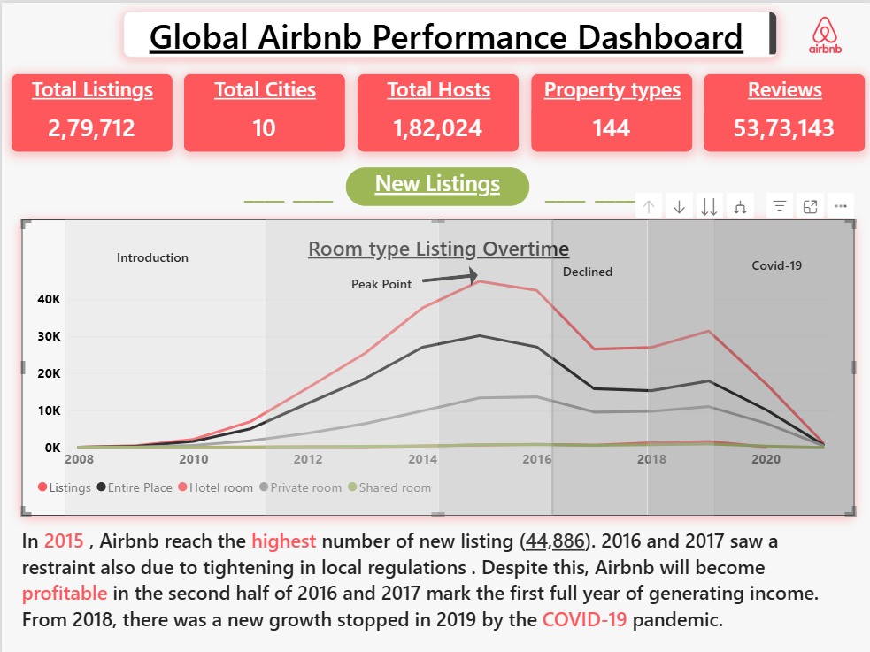
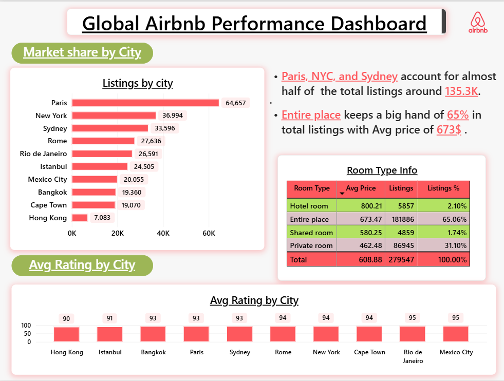

# Global Airbnb Performance Dashboard

## Project Overview
This project presents an interactive Power BI dashboard for analyzing Airbnb's global performance across 10 cities. It explores listing trends, room types, host activity, review distribution, average ratings, pricing, and host verification.

## Dashboard Preview

### 1. Global Performance and Listing Trends

### 2. City-Wise Listings and Market Share

### 3. Reviews and Host Analysis

## Key Performance Indicators (KPIs)
- **Total Listings:** 279,712
- **Total Cities:** 10
- **Total Hosts:** 182,024
- **Property Types:** 144
- **Total Reviews:** 53,73,143
- **Host IDs Displayed in Reviews Dashboard:** 132.39K

## Dashboard Features
1. **Global Listing Trends:** Tracks changes in listings and room types over time.
2. **City-Wise Analysis:** Compares listing counts across Paris, New York, Sydney, Rome, Rio de Janeiro, Istanbul, Mexico City, Bangkok, Cape Town, and Hong Kong.
3. **Room Type Analysis:** Examines listing distribution, average prices, and market share by room type.
4. **Review Analysis:** Compares review distribution across selected cities.
5. **Host Analysis:** Examines host verification and profile picture status.
6. **Rating Analysis:** Compares average city ratings.
7. **Date Filtering:** Enables analysis over a selected time range.

## Tools and Technologies
- Microsoft Power BI
- Data visualization and business intelligence
- Power Query
- DAX measures
- Excel or SQL

## Key Observations
- Paris has the highest listing count among the cities displayed, with 64,657 listings.
- Entire-place listings represent approximately 65.06% of the listings in the displayed room-type table.
- The listing trend chart shows a peak in 2015, followed by a decline in subsequent years.
- Mexico City and Rio de Janeiro have the highest displayed average city ratings, at 95.
- The host analysis dashboard reports approximately 73.28% verified hosts and 99.76% hosts with profile pictures.

## Author
Aryan Nayak
